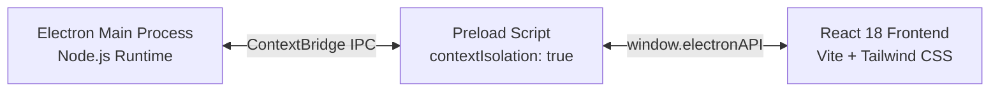

# ⚡ GitPulse

<div align="center">


**A sleek, minimalist desktop utility designed for developers to monitor daily GitHub activity, preserve commit streaks with real-time countdowns and smart alerts, and generate instant commit fuel.**

[Features](#-features) • [Installation](#-installation--setup) • [Architecture](#-architecture--security) • [Settings](#-configuration) • [Author](#-author)

</div>

---

## 🌟 Overview

**GitPulse** is a frameless desktop utility running unobtrusively in your system tray and on your desktop. It connects to the public GitHub API to track your daily pushes in real time. If your commit streak is at risk as midnight approaches, GitPulse alerts you via native Windows notifications and optional Discord webhook alerts.

```
+-----------------------------------------------------------+
| [⚡ GitPulse]             🟢 Active   [⚙️]  [-]  [X]      |
+-----------------------------------------------------------+
|                                                           |
|   +---------------------------------------------------+   |
|   |  🔥 STREAK SAFE                 ⏳ 03h 42m 18s   |   |
|   |  3 commits pushed today         Until midnight    |   |
|   +---------------------------------------------------+   |
|                                                           |
|   [🚀 Commit Fuel Generator]                              |
|   +---------------------------------------------------+   |
|   | feat(auth): add OAuth2 PKCE token exchange flow   |   |
|   +---------------------------------------------------+   |
|   [Feat] [Fix] [Chore] [Refactor] [Witty]   [📋 Copy]     |
|                                                           |
+-----------------------------------------------------------+
```

---

## 🚀 Features

- **🪟 Sleek Frameless Window (380×570px):**
  - Ultra-dark theme (`#090d16`) with glassmorphism touches and ambient glow accents.
  - Custom draggable titlebar with smooth minimize and close-to-tray controls.
  - Centered on launch and permanently accessible in the Windows Taskbar with high-res GitHub branding.

- **📊 Live GitHub Streak Monitor:**
  - Queries public activity events (`https://api.github.com/users/{username}/events`).
  - Displays instant visual badges: **🟢 Glowing Green (Streak Active)** when code has been pushed today, or **🔴 Alert Red (Pending)** when no commits have been pushed yet.
  - Shows total commits pushed today along with recent repository tags.

- **⏳ Midnight Countdown Ticker:**
  - Precision real-time countdown (`HH:mm:ss`) to midnight local time, showing exactly how long you have left to push code and preserve your streak.

- **🔔 Customizable Daily Streak Reminders:**
  - Configure your preferred daily alert time (e.g. `17:00`, `18:00`, `20:00`, `21:30`, or custom time).
  - Triggers rich native desktop notifications with sound if no commits have been detected before the deadline.
  - Clicking the notification instantly brings the application window to the foreground.

- **💬 Discord Webhook Integration (Optional):**
  - Send automated streak alerts directly to your personal Discord server or channel via incoming webhooks.
  - Includes built-in "Send Test Notification Now" to verify your setup in seconds.

- **💡 Instant Commit Fuel Generator:**
  - Never get stuck writing commit messages. Generates conventional commits (`feat: ...`, `fix: ...`, `refactor: ...`, `chore: ...`) and developer humor with a single click.
  - One-tap clipboard copy with visual confirmation.

- **🛡️ Silent System Tray & Background Operation:**
  - Closing the window (`X`) minimizes GitPulse to the Windows system tray (near the clock).
  - Tray icon reflects your live commit status (Green / Red pulse).
  - Quick tray menu: Open, Refresh Now, Always On Top toggle, and Clean Exit.

- **🔒 Privacy First & Offline Ready:**
  - No account creation required. No tracking or telemetry.
  - All preferences (username, reminder times, webhook URLs) are stored exclusively on your local machine via `localStorage`.

---

## 🛠️ Architecture & Security

GitPulse follows the Electron best-practice security model:



- **`contextIsolation: true`** & **`nodeIntegration: false`**: Completely isolates the renderer process from Node.js system APIs.
- **Strict Content Security Policy (CSP)**: Locks script execution to self and restricts network access exclusively to GitHub APIs, Google Fonts, and Discord Webhooks.
- **Robust Single-Instance Lock**: Prevents duplicate background processes; opening GitPulse while minimized brings the existing window to the front.

---

## 📦 Installation & Setup

### Prerequisites
- [Node.js](https://nodejs.org/) `>= 18.x` (LTS recommended)
- [npm](https://www.npmjs.com/) `>= 9.x`

### 1. Clone the Repository
```bash
git clone https://github.com/Andreyy05/GitPulse.git
cd GitPulse
```

### 2. Install Dependencies
```bash
npm install
```

### 3. Run in Development Mode
Starts the Vite dev server with Hot Module Replacement (HMR) and launches the Electron desktop shell simultaneously:
```bash
npm run dev
```

### 4. Build Standalone Executable
Compile the React bundle and build the standalone Windows application (`dist-electron/win-unpacked/GitPulse.exe`):
```bash
npm run build
```

---

## ⚙️ Configuration

1. Click the **Settings ⚙️** icon in the top header.
2. **GitHub Username**: Enter your GitHub username (e.g., `Andreyy05`).
3. **Background Refresh**: Choose your polling interval (`5m`, `15m`, `30m`, or `60m`).
4. **Daily Streak Reminder**: Toggle on/off and select your desired notification time (e.g., `18:00` or custom).
5. **Discord Webhook (Optional)**: Paste a Discord Webhook URL to receive alerts directly in your channel.
6. Click **Send Test Notification Now** to verify alerts, then click **Save Settings**.

---

## 📂 Project Structure

```text
GitPulse/
├── assets/                  # High-resolution application and tray icons (.ico, .png)
├── electron/
│   ├── main.cjs             # Electron main process (lifecycle, tray, IPC handlers)
│   ├── preload.cjs          # Secure IPC contextBridge exposure
│   └── trayIcon.cjs         # Dynamic system tray graphics generator
├── src/
│   ├── components/
│   │   ├── CommitFuel.jsx   # Commit message generator & clipboard utility
│   │   ├── Header.jsx       # Custom draggable titlebar & controls
│   │   ├── SettingsModal.jsx# Onboarding & configuration modal
│   │   └── StatusCard.jsx   # Streak status badge, timer & commit stats
│   ├── services/
│   │   ├── commitFuel.js    # Curated conventional & humorous commit library
│   │   ├── github.js        # GitHub Events API parser & streak calculator
│   │   └── notifications.js # Desktop toast & Discord webhook dispatcher
│   ├── App.jsx              # Root reactive state management & alert scheduler
│   ├── index.css            # Tailwind directives & glassmorphic styling
│   └── main.jsx             # React DOM entry point
├── index.html               # Main application HTML shell with strict CSP
├── package.json             # Scripts & dependencies
├── tailwind.config.js       # Custom dark-mode color palette & animations
└── vite.config.js           # Vite build pipeline & React plugin configuration
```

---

## 👤 Author

**Andrej Pavliščak**
- GitHub: [@Andreyy05](https://github.com/Andreyy05)

---

## 📄 License

This project is licensed under the [MIT License](LICENSE).
