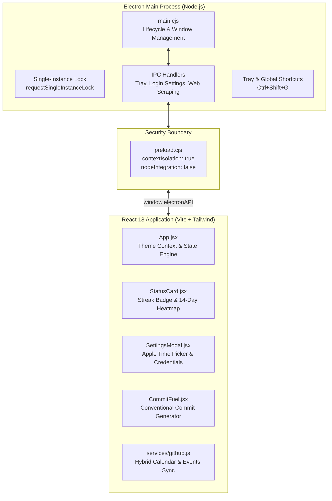

# ⚡ GitPulse

<div align="center">


**A minimalist, Apple/Raycast-inspired desktop utility for developers to monitor daily GitHub streaks, preserve momentum with real-time countdowns and smart alerts, inspect 14-day contribution heatmaps, and generate instant commit fuel.**

[Features](#-key-features) • [Installation & Setup](#-installation--setup) • [Architecture](#-architecture--security) • [Keyboard Shortcuts](#-keyboard-shortcuts) • [Configuration](#-configuration) • [Project Structure](#-project-structure) • [License](#-license)

</div>

---

## 🌟 Overview

**GitPulse** is a lightweight, frameless companion application crafted specifically for active software engineers. It sits unobtrusively on your desktop or system tray, keeping your GitHub streak top-of-mind without cluttering your workflow.

By pairing direct GitHub profile contribution calendar scraping with real-time push event parsing, GitPulse delivers a 100% accurate, zero-lag view of your daily commits. When evening approaches and your streak is still at risk, GitPulse notifies you via native Windows notifications and optional Discord webhook alerts so you never lose a streak again.

```text
┌─────────────────────────────────────────────────────────────┐
│ ⚡ GitPulse   ● Safe today              [⚙️]  [-]  [□]  [✕] │
├─────────────────────────────────────────────────────────────┤
│                                                             │
│   @Andreyy05                                      [🔄 Sync] │
│   Synced 13:00                                              │
│                                                             │
│   ┌─────────────────────────────────────────────────────┐   │
│   │  ● STREAK ACTIVE                         Safe today │   │
│   │                                                     │   │
│   │  14  14 commits pushed today                        │   │
│   │      Streak secured for today                       │   │
│   │                                                     │   │
│   │  ⏱ Time until midnight:            10h : 52m : 15s  │   │
│   │  [==================================----------]     │   │
│   │                                                     │   │
│   │  📅 14-Day Activity               54 commits total  │   │
│   │  [■][■][ ][■][ ][ ][ ][ ][■][■][■][■][■][■]         │   │
│   │  14d ago           Less ■ ■ ■ ■ More          Today │   │
│   └─────────────────────────────────────────────────────┘   │
│                                                             │
│   ┌─────────────────────────────────────────────────────┐   │
│   │  🔥 Commit Fuel                      [Mix|Clean|Witty]│   │
│   │                                                     │   │
│   │  feat(auth): integrate OAuth2 PKCE exchange  [📋]   │   │
│   └─────────────────────────────────────────────────────┘   │
└─────────────────────────────────────────────────────────────┘
```

---

## ✨ Key Features

### 📊 Real-Time GitHub Streak & Activity Engine
- **Hybrid Sync Technology:** Combines official GitHub contribution calendar data (`/contributions`) with GitHub's Event Stream API. Eliminates API event lag, accurately tracking pushes to public and private repos alike.
- **Accurate 14-Day Contribution Heatmap:** High-fidelity 14-day contribution cells matching GitHub's official profile graph color intensity (`0`, `1–2`, `3–5`, `6+` commits).
- **Interactive Tooltips & Today Highlight:** Hover over any day in the heatmap to view exact calendar dates and contribution counts; today's square features an accentuated border ring.
- **Instant Visual Streak Badges:** 
  - **🟢 STREAK ACTIVE** — Code pushed today, streak safely preserved.
  - **🟡 PENDING PUSH / STREAK AT RISK** — Visual amber warning when 0 commits are recorded for today.
- **Celebration Confetti:** Automatically triggers smooth, particle-physics confetti bursts upon reaching or verifying your daily goal.

### 🎨 Apple & Raycast-Inspired Design
- **Dual Light & Dark Theme Support:**
  - **Dark Mode:** Deep zinc `#09090b` / `#090d16` background with subtle borders and glowing emerald accents.
  - **Light Mode:** Crisp Apple-style `#f4f5f7` canvas with pure white elevated cards, high-contrast typography, and soft drop shadows.
  - **System Synchronized:** Matches your operating system preference automatically.
- **Flicker-Free Native Frame:** IPC theme dispatch synchronizes Electron's native background color dynamically to avoid window resize/reopen flashing.

### ⏱️ Custom Inline Apple Time Selector
- **Monospace Dual-Cell Input:** Custom `[ HH ] : [ MM ]` editor with built-in clamping (`00–23` hours, `00–59` minutes).
- **Fluid Keyboard UX:** Automatic jump to minutes on 2 digits or colon (`:`), arrow key increment/decrement with cyclical rollover, and backspace auto-reversion.
- **Quick Preset Pills:** One-click presets (`17:00`, `18:00`, `20:00`, `21:30`) with active pill highlighting.

### 🔔 Smart Multi-Channel Notifications
- **Precision Countdown Ticker:** Shows exact hours, minutes, and seconds remaining until midnight in your local computer timezone.
- **Native Windows Desktop Alerts:** Dispatches rich system notifications if no commits have been pushed by your scheduled reminder time. Clicking the alert immediately focuses the window.
- **Discord Webhook Forwarding (Optional):** Automatically post streak reminders to your private channel or developer server. Includes a one-click test button.
- **Rate-Limit Resilience:** Supports GitHub Personal Access Tokens (PAT) to boost hourly API quotas from 60 to 5,000 requests/hour, with automatic reset time display.

### ⚙️ Operating System Integration
- **Single-Instance Enforcement:** Guards against duplicate processes via `app.requestSingleInstanceLock()`. Launching a second instance smoothly focuses and unminimizes the existing window.
- **Global Keyboard Shortcut:** Toggle GitPulse visibility from anywhere across Windows with **`Ctrl + Shift + G`** (or `Cmd + Shift + G`).
- **Tray Resident:** Minimizes cleanly to the notification area; dynamic tray icon reflects live status (`🟢` Safe / `🔴` Pending).
- **Windows Startup Toggle:** Configures auto-launch on Windows login with a single toggle switch.

### 💡 Instant Commit Fuel Generator
- **Conventional Commits & Humor:** Generates structured messages (`feat: ...`, `fix: ...`, `chore: ...`, `refactor: ...`) or developer humor.
- **One-Click Copy:** Instant clipboard copy with visual feedback.

---

## 🛠️ Architecture & Security

GitPulse strictly complies with Electron's modern security recommendations:



- **Isolated Renderer:** `contextIsolation: true`, `nodeIntegration: false`, and `sandbox: false` with strictly validated ContextBridge APIs.
- **Content Security Policy (CSP):** Restricts script evaluation exclusively to `'self'`, allows Web Workers for confetti (`worker-src 'self' blob:;`), and locks external network calls solely to `api.github.com`, `github.com`, and `discord.com`.

---

## ⌨️ Keyboard Shortcuts

| Shortcut | Scope | Action |
| :--- | :--- | :--- |
| **`Ctrl + Shift + G`** | Global (System-Wide) | Toggle GitPulse window visibility (Show / Hide to Tray) |
| **`Esc`** | In-App | Close Settings Modal |
| **`↑` / `↓`** | In-App (Time Input) | Increment / Decrement Hours or Minutes |
| **`:`** or **`Enter`** | In-App (Hours Input) | Auto-advance focus to Minutes |
| **`Backspace`** | In-App (Minutes Input) | Auto-revert focus back to Hours |

---

## 📦 Installation & Setup

### Prerequisites
- [Node.js](https://nodejs.org/) `>= 18.x` (LTS recommended)
- [npm](https://www.npmjs.com/) `>= 9.x`
- Windows 10/11 (64-bit)

### 1. Clone & Install
```bash
git clone https://github.com/Andreyy05/GitPulse.git
cd GitPulse
npm install
```

### 2. Development Mode
Runs the Vite development server with Hot Module Replacement (HMR) and concurrently spawns the Electron shell:
```bash
npm run dev
```

### 3. Build & Package
Build the optimized React bundle and package the standalone executable:
```bash
# Full build (Vite + unpackaged Electron binary)
npm run build

# Standalone output path:
# dist-electron/win-unpacked/GitPulse.exe
```

---

## ⚙️ Configuration

Open **Settings (⚙️)** in the top-right corner to customize your experience:

1. **Appearance:** Select **Dark**, **Light**, or **System** mode.
2. **GitHub Username:** Enter your username (e.g. `Andreyy05`).
3. **Personal Access Token (PAT) (Optional):**
   - Provide a classic or fine-grained token with `public_repo` or `read:user` scope.
   - Increases your API rate-limit quota from 60 to 5,000 requests per hour.
4. **Background Refresh Rate:** Set automatic polling to `5`, `15`, `30`, or `60` minutes.
5. **Launch at Startup:** Automatically start GitPulse silently in the system tray when logging into Windows.
6. **Daily Streak Reminder:** Toggle alerts and adjust the reminder time (`18:00`, presets, or custom).
7. **Discord Webhook (Optional):** Enter your Discord channel webhook URL and click **Send Test Notification** to confirm delivery.

---

## 📂 Project Structure

```text
GitPulse/
├── assets/
│   ├── icon.ico                 # Multi-resolution Windows application icon
│   └── icon.png                 # High-resolution PNG logo
├── electron/
│   ├── main.cjs                 # Main process, lifecycle, IPC handlers, single-instance
│   ├── preload.cjs              # ContextBridge API bindings
│   └── trayIcon.cjs             # Procedural SVG system tray icon generator
├── src/
│   ├── components/
│   │   ├── CommitFuel.jsx       # Commit generator with category tabs & copy feedback
│   │   ├── Header.jsx           # Frameless window bar, theme controls & window actions
│   │   ├── SettingsModal.jsx    # Apple segmented theme & custom inline time picker
│   │   └── StatusCard.jsx       # Real-time badge, 14-day heatmap & countdown progress
│   ├── services/
│   │   ├── commitFuel.js        # Curated conventional commit library
│   │   ├── github.js            # Hybrid GitHub scraping & Events API synchronization
│   │   └── notifications.js     # Desktop notifications & Discord webhook dispatcher
│   ├── App.jsx                  # Main application state, theme observer & auto-sync
│   ├── index.css                # Tailwind base styles, custom scrollbars & fonts
│   └── main.jsx                 # React root bootstrap
├── index.html                   # HTML shell with hardened Content Security Policy
├── package.json                 # Scripts, dependencies & electron-builder metadata
├── tailwind.config.js           # Extended Apple/Raycast color palette & tokens
└── vite.config.js               # Vite build configuration with relative base paths
```

---

## 🤝 Contributing

Contributions, feature requests, and bug reports are welcome!
1. Fork the Project
2. Create your Feature Branch (`git checkout -b feature/AmazingFeature`)
3. Commit your Changes (`git commit -m 'feat: add some amazing feature'`)
4. Push to the Branch (`git push origin feature/AmazingFeature`)
5. Open a Pull Request

---

## 👤 Author

**Andrej Pavliščak**
- GitHub: [@Andreyy05](https://github.com/Andreyy05)

---

## 📄 License

This project is licensed under the **MIT License** — see the [LICENSE](LICENSE) file for details.
